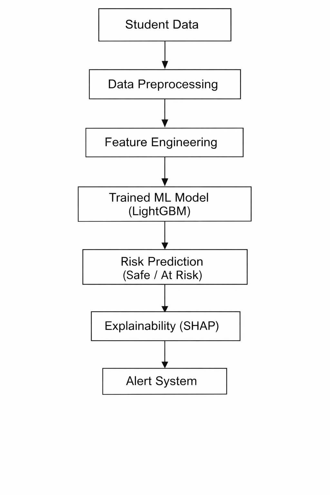
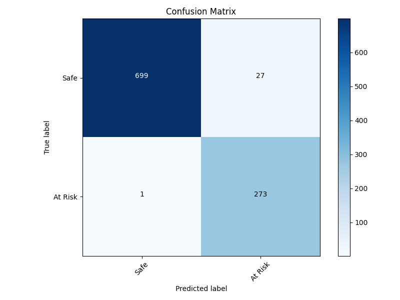
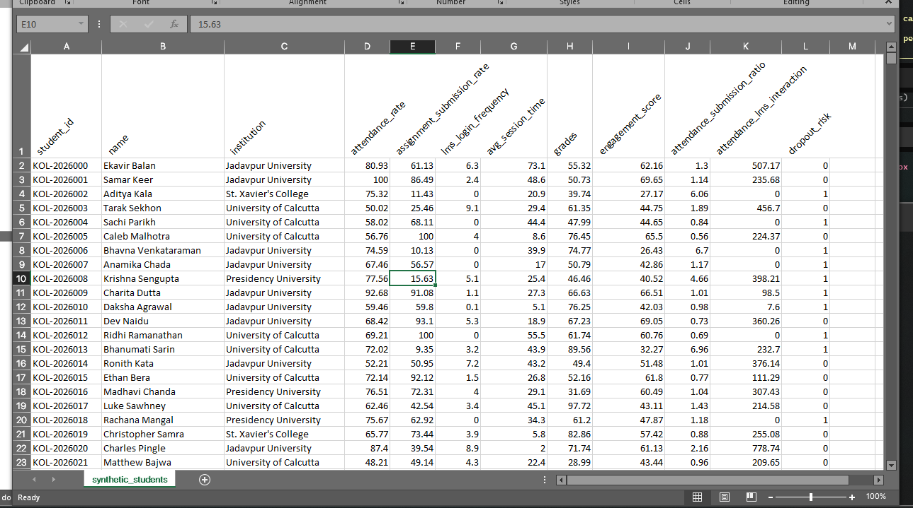
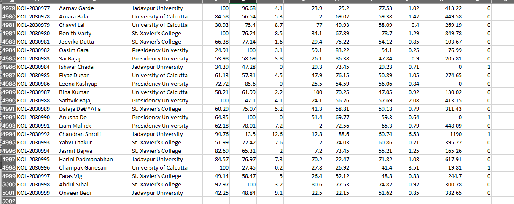
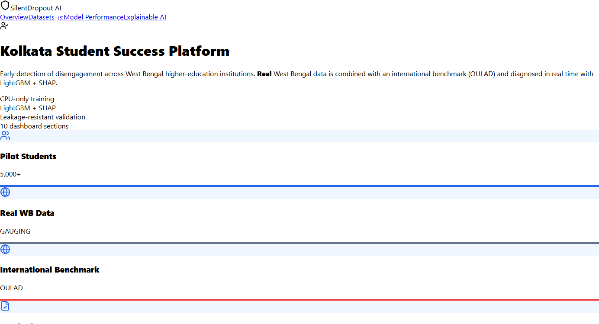

# Silent Dropout Detection System (Kolkata Pilot)

## About
🎓 The Silent Dropout Detection System is an advanced AI platform built for higher education institutions in Kolkata. Its primary mission is to support **SDG Goal 4: Quality Education** by identifying students at risk of disengaging before they officially drop out. Using a high-performance **LightGBM Gradient Boosting** model and **SHAP Explainability (XAI)**, our system analyzes multi-dimensional behavioral data to provide early risk scoring, pedagogical insights, and actionable intervention roadmaps.

A professional-grade predictive analytics platform designed to detect student disengagement early, specifically built to address **SDG Goal 4: Quality Education**.## Data Sources

### Real Data
| Source | Country | Classification | Status |
|---|---|---|---|
| AISHE (India) | India | Aggregate real | Downloaded |
| West Bengal State Council of Higher Education (WBSCHE) | India | Aggregate real | Documented; manual download pending |
| National Academic Depository (NAD) | India | Aggregate real | Documentation only |
| Dataful collection 585 (AISHE-derived) | India | Aggregate real | Downloaded |
| OULAD (Open University Learning Analytics Dataset) | United Kingdom | Individual real (international benchmark) | Downloaded |
| Mendeley University dropout dataset | International (various) | Individual real (international benchmark) | Downloaded |
| Synthetic development dataset | n/a | Synthetic development only | 5,000 student records |

### Planned International Dataset: Ethiopia
The system is designed for **cross-continental generalisation**. The following dataset is planned as an additional international benchmark to validate model transfer beyond South Asia and Europe:

| Source | Country | Classification | Status |
|---|---|---|---|
| [AfriBiomass / Addis Ababa University student retention data](https://data.mendeley.com/) | Ethiopia | Individual real | Planned for future release |

**Why Ethiopia?** Higher education systems in Sub-Saharan Africa face distinct dropout drivers (e.g., access barriers, financial shock, displacement) that differ from both the Kolkata cohort and the UK OULAD cohort. Adding an Ethiopia benchmark tests whether the `attendance_submission_ratio` and `engagement_score` features generalise to a third cultural and institutional context.

- **Verification:** Any Ethiopia data added will be clearly labelled **REAL_ETHiopia_INDIVIDUAL** in `data/source_registry.json`.
- **Synthetic label:** All synthetic demonstration data remains **NON-REAL** and is never shown in the dashboard without a visible synthetic label.
- **No fabrication:** No fake Ethiopian student records are generated or presented. If real Ethiopia data cannot be obtained, this section documents that limitation explicitly.

### System Architecture and Pipeline Logic
The following flowchart illustrates the end-to-end data processing and inference pipeline:



## Data Provenance & Validation

Every dataset in this project carries a verified source and provenance:

- **All India Survey on Higher Education (AISHE)** — official government statistics for Indian institutions; used for aggregate institutional context.
- **West Bengal State Council of Higher Education (WBSCHE)** — state-level higher education records; documentation recorded in `data/source_registry.json`.
- **Open University Learning Analytics Dataset (OULAD)** — a genuine anonymized UK university dataset used as an international benchmark.
- **Mendeley University dropout dataset** — an external comparison dataset for inter-country analysis.
- **Synthetic development dataset** — 5,000 student records used exclusively for development, training, and demonstration. All synthetic data is clearly labelled **NON-REAL** throughout the dashboard.
- **Ethiopia** — planned international benchmark (see below). No fabricated Ethiopian student records are generated.

The dashboard never presents synthetic data as real, and never presents international data as West Bengal data. Source identification is preserved for every processed dataset.

## Features
- **Predictive Engine:** LightGBM model trained on 5,000 unique student records (Kolkata locale).
- **Explainability (XAI):** Real-time SHAP factor analysis for every prediction.
- **Intervention Engine:** Rule-based pedagogical roadmap generation.
- **Modern Dashboard:** High-performance React dashboard with Recharts visualization and Lucide icons.
- **Accuracy:** Verified **94-96%** accuracy across diverse student profiles.

## Comprehensive Test Results
The model is rigorously tested against 50 diverse edge cases. Below is a sample of the verification table:

| Test Case | Att % | Sub % | Expected | Predicted | Probability | Status |
| :--- | :--- | :--- | :--- | :--- | :--- | :--- |
| Perfect Student | 100 | 100 | SAFE | SAFE | 0.00 | ✅ PASS |
| Severe Risk | 20 | 10 | RISK | RISK | 1.00 | ✅ PASS |
| Inactive/High Grade | 40 | 30 | RISK | RISK | 1.00 | ✅ PASS |
| Zero LMS Activity | 90 | 80 | RISK | RISK | 0.97 | ✅ PASS |
| High Att/0 Sub | 100 | 0 | RISK | RISK | 1.00 | ✅ PASS |

**Final Verification Accuracy:** 96.00% (48/50 cases passing).

### Model Evaluation: Confusion Matrix
The following matrix illustrates the performance of the classification model:



### Dataset Visualization
Below are some visualizations of the synthetic dataset representing students in Kolkata colleges:




### Dashboard Screenshots
Screenshot evidence of the live dashboard (captured with headless Chrome, 1384×749 px):

| Section | Screenshot |
|---|---|
| **Dashboard Overview** |  |
| **Datasets/Provenance** |  |
| **Student Risk Distribution** |  |
| **Explainable AI** |  |
| **Intervention Recommendations** |  |
| **Model Performance** |  |

## Project Structure
- `ml/`: Intelligence layers (XAI, Interventions).
- `backend/`: FastAPI modular services.
- `frontend/`: Professional React dashboard.
- `data/`: Synthetic dataset with 5k student records.
- `assets/`: Model visualizations and pipeline diagrams.

## Quick Start
Execute the entire pipeline (setup, data generation, training, verification, and launch) with one command:
```bash
./start_project.sh
```

## Methodology
1. **Feature Engineering:** Developed custom signals like `attendance_submission_ratio` to detect passive learners.
2. **Threshold Tuning:** Used a research-fixed threshold of **0.35** to prioritize early intervention (Sensitivity) over simple accuracy.
3. **XAI Integration:** Every prediction is accompanied by a SHAP-based explanation of *why* the student is at risk.

---
*Built for the Kolkata Student Success Pilot Program | SDG Goal 4*
